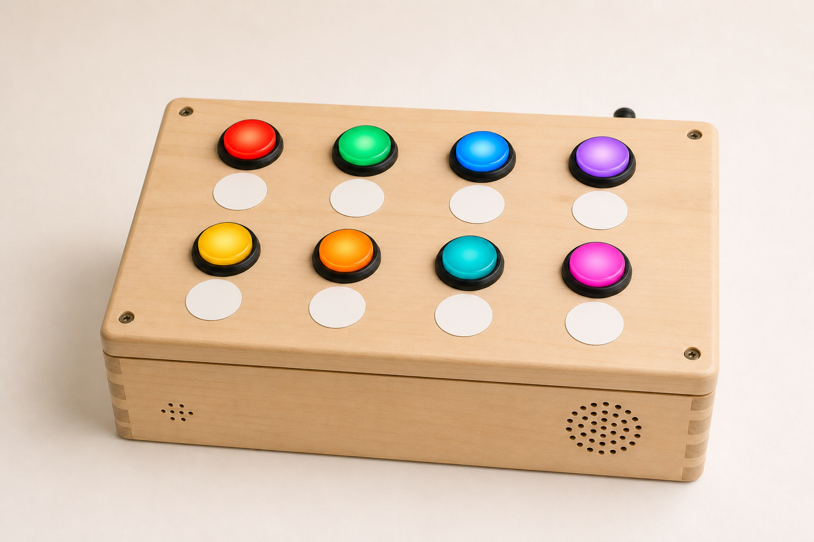
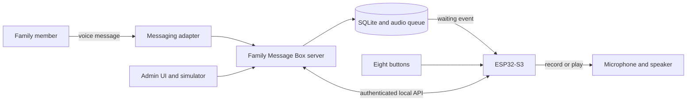

<div align="center">



# Family Message Box

**Turn voice messages into something you can see, touch, and share.**

An open-source, eight-button voice-message box for families and makers.

[](LICENSE)
[](package.json)
[](firmware/)
[](firmware/enclosure/)

[Try the software](#quick-start) · [Build the box](#build-the-physical-box) · [Explore the CAD](firmware/enclosure/) · [Contribute](CONTRIBUTING.md)

</div>

## Why Family Message Box?

Voice messages are personal, but phones can make them feel distant.

Family Message Box gives every person a physical button. Hold their button to
record a message. Release it to send. When their button flashes, press it to
hear every waiting message.

No menus. No scrolling. Just a familiar person, colour, and action.

Everything needed to recreate the reference build lives in this repository:
software, firmware, wiring, CAD source, printable files, and testing tools.

## Highlights

- **Eight physical connections.** Assign one illuminated button per person.
- **Tactile voice messaging.** Hold to record, release to send, press to play.
- **Private by default.** Keep the box inside your trusted home network.
- **Complete maker build.** Use the BOM, wiring guide, OpenSCAD, and STLs.
- **Safe experimentation.** Test every flow with the built-in hardware simulator.
- **Reliable playback.** Stream normalized audio directly to the ESP32-S3.
- **Recoverable delivery.** Retain failed uploads and avoid ambiguous duplicate sends.
- **Signed updates.** Package and verify optional firmware updates over the air.
- **Open by design.** Modify, share, remix, and contribute under the MIT License.

## How it works



The ESP32-S3 handles buttons, lamps, recording, playback, and device updates.
The Node.js server owns assignments, queues, audio conversion, and messaging.
The browser app manages the box and simulates its hardware.

### The everyday flow

| Action                  | Box behaviour                               |
| ----------------------- | ------------------------------------------- |
| Hold a person’s button  | Record a voice message for that person      |
| Release the button      | Upload and send the recording               |
| Receive a voice message | Flash the matching person’s button          |
| Press a flashing button | Play that person’s waiting messages         |
| Finish playback         | Acknowledge the message and update the lamp |

## Quick start

Explore the complete workflow without hardware or a messaging account.

### Requirements

- Node.js 22 or newer
- npm
- FFmpeg

### Run locally

Clone or download the repository. Run these commands from its root directory.

```bash
./setup.sh
npm run dev
```

Open `http://localhost:5173`.

Choose **Button simulator**. Assign a recipient, add an incoming message, then
press the matching button. The default mock adapter never contacts real users.

### Run with Docker

```bash
cp .env.example .env
docker compose up --build
```

Open `http://localhost:8787`.

Docker stays on your computer by default. Read the
[deployment guide](docs/DEPLOYMENT.md) before sharing it across your network.

## Build the physical box

The reference build uses an ESP32-S3 N16R8 and eight illuminated arcade buttons.

1. Review the [bill of materials](firmware/BILL_OF_MATERIALS.md).
2. Follow the [hardware build guide](firmware/HARDWARE_BUILD.md).
3. Print the three validated [STL exports](firmware/enclosure/exports/).
4. Adjust the editable [OpenSCAD model](firmware/enclosure/family_message_box.scad).
5. Configure Wi-Fi and API settings in an ignored local header.
6. Build and flash the supported firmware.
7. Complete every electrical, audio, and enclosure acceptance check.

```bash
cp firmware/include/device_config.example.h firmware/include/device_config.h
pio run -d firmware -e esp32-s3-wroom-1-n16r8
```

Machine-specific G-code is intentionally excluded. Import the supplied Cura
profiles, inspect every layer, and regenerate the toolpath for your printer.

### Printable parts

| Part                                      | Purpose                                     |
| ----------------------------------------- | ------------------------------------------- |
| `family-message-box-base.stl`             | Main enclosure and protected audio openings |
| `family-message-box-control-lid.stl`      | Eight-button lid with eight label positions |
| `family-message-box-electronics-tray.stl` | Internal ESP32 and electronics carrier      |

Regenerate and validate every export after changing the CAD source.

```bash
./firmware/enclosure/export.sh
node firmware/enclosure/validate_exports.mjs
```

## Messaging adapters

| Adapter         | Best for                               | Status                                        |
| --------------- | -------------------------------------- | --------------------------------------------- |
| Mock            | Development, demonstrations, and tests | Supported and enabled by default              |
| Twilio WhatsApp | Provider-backed messaging              | Supported; credentials and HTTPS required     |
| WhatsApp Web    | Community experimentation              | Prototype source only; dependency not bundled |

The WhatsApp Web browser dependency currently has unresolved upstream security
issues. The public installation excludes it while retaining the adapter source.

## Project map

```text
apps/
  admin/                 Browser admin and hardware simulator
  server/                API, queues, audio, adapters, and SQLite
packages/
  contracts/             Shared protocol types
  device-core/           Shared device behaviour
firmware/
  src/                    ESP32-S3 firmware
  include/                Pins, tuning, contracts, and examples
  enclosure/              OpenSCAD, STLs, previews, and Cura profiles
docs/                     Architecture and deployment guides
scripts/                  Verification, deployment, and firmware tooling
```

Read the [architecture overview](docs/ARCHITECTURE.md) before changing device
contracts, queue behaviour, audio formats, or messaging boundaries.

## Project status

Family Message Box is a working reference project and an evolving maker platform.

- The mock workflow, server, admin UI, and native firmware tests are automated.
- The reference ESP32-S3 firmware and printable CAD exports build successfully.
- Home-network deployment and optional signed OTA tooling are included.
- Hardware substitutions still require electrical and mechanical verification.
- The enclosure is child-deterrent, not certified child-safe.
- The project is independent, open source, and community-driven.

Expect careful changes around power, audio, privacy, delivery, and physical safety.

## Documentation

| Guide                                              | Use it for                                        |
| -------------------------------------------------- | ------------------------------------------------- |
| [Architecture](docs/ARCHITECTURE.md)               | Understand responsibilities and system boundaries |
| [Deployment](docs/DEPLOYMENT.md)                   | Run Docker safely at home                         |
| [Bill of materials](firmware/BILL_OF_MATERIALS.md) | Select compatible electronics and hardware        |
| [Hardware build](firmware/HARDWARE_BUILD.md)       | Wire, assemble, inspect, and test the box         |
| [Enclosure](firmware/enclosure/README.md)          | Print, modify, and validate the physical design   |
| [Contributing](CONTRIBUTING.md)                    | Prepare changes and verification evidence         |
| [Security](SECURITY.md)                            | Report vulnerabilities and protect private data   |

## Created by Daniel Graetzer

Daniel Graetzer created Family Message Box as a personal maker build.
It makes remote family communication feel physical, simple, and approachable.

The public edition shares the complete design for others to recreate and improve.
Its best future will come from builders testing new parts, homes, and needs.

## Contributing

Contributions are welcome from developers, makers, designers, and documenters.

Useful starting points include:

- create enclosure variants for different printers or button sizes;
- improve accessibility through tactile labels, sounds, and interaction choices;
- add documented messaging adapters with strong privacy boundaries;
- improve audio quality, offline behaviour, and connection recovery;
- translate setup and assembly guidance;
- test alternative boards, amplifiers, speakers, and microphones;
- simplify the first-build experience.

Read [CONTRIBUTING.md](CONTRIBUTING.md) before opening a pull request. Follow the
[Code of Conduct](CODE_OF_CONDUCT.md) in every project space.

Run the complete software gate before submitting code.

```bash
npm ci
npm run verify
npm audit --audit-level=high
```

Firmware changes also require the PlatformIO build. CAD changes require fresh,
validated exports. Report physical testing separately from automated results.

## Security and safety

This project handles private audio and controls physical electronics.

- Keep the admin and device APIs inside a trusted home network.
- Never commit credentials, phone numbers, recordings, databases, or private keys.
- Never expose the admin or device API through router port-forwarding.
- Inspect power, fusing, insulation, strain relief, heat, and loose parts.
- Supervise child use and inspect the enclosure regularly.
- Report vulnerabilities privately through [SECURITY.md](SECURITY.md).

> [!IMPORTANT]
> Family Message Box is not a certified toy or safety-rated consumer product.
> Adult assembly, electrical inspection, child-safe finishing, and supervision
> are required.

## License

Family Message Box is available under the [MIT License](LICENSE). It permits
commercial and non-commercial reuse.

Use it, modify it, share it, and build on it freely. Third-party components keep
their own licenses and warranties. Hardware construction remains the builder’s
responsibility.

---

<div align="center">

**Build one. Improve it. Help voice messages feel human again.**

</div>
